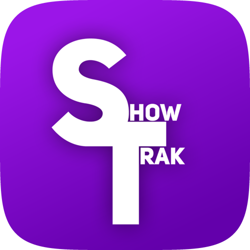

# ShowTrak Server

**Monitor and control every computer and show device from one screen.**

[Website](https://showtrak.co.uk/software/server) · [Download](https://showtrak.co.uk/software/server/downloads) · [Documentation](https://showtrak.co.uk/docs/server) · [Discord](https://discord.gg/DACmwsbSGW)

[![Windows][badge-windows]](https://showtrak.co.uk/software/server/downloads) [![macOS][badge-macos]](https://showtrak.co.uk/software/server/downloads) [![Linux][badge-linux]](https://showtrak.co.uk/software/server/downloads) [![Raspberry Pi][badge-raspberrypi]](https://showtrak.co.uk/software/server/downloads) [![CI status][badge-ci]](https://github.com/ShowTrak/ShowTrakServer/actions/workflows/ci.yml)

ShowTrak Server is the control room for your show, venue or attraction. It watches every
computer running [ShowTrak Client](https://github.com/ShowTrak/ShowTrakClient) and the show
equipment around them, tells you the moment something goes wrong, and lets you fix it from your
desk: restart an app, run a script, wake a machine.

Free, built for live entertainment, and used in immersive theatre, attractions and venues across
the UK.

## Key features

- **Everything at a glance**: every machine shows as online, offline or degraded, with CPU, memory, temperatures, displays, audio devices, USB devices and running applications.
- **Monitors your show kit too**: projectors, lighting and sound consoles, media servers, wireless mics, UPSes and network services, including QLab, ETC Eos, grandMA, disguise, Resolume, Blackmagic, Shure, Sennheiser, Q-SYS, Dante, Art-Net, sACN and PJLink.
- **Alerts that reach you**: know when a machine drops off, an app freezes or closes, a USB device or display is unplugged, a computer overheats or a check fails. Get a sound, a pop-up, a Discord, Slack, Teams or Telegram message, an OSC cue or a webhook.
- **Run scripts remotely**: restart apps, reboot, shut down or run your own scripts on one machine or a whole group, with live progress and output. Start from a library of ready-made sample scripts.
- **One-click setup**: computers running ShowTrak Client are found on the network automatically. Adopt them with one click and organise them into groups and tags.
- **Wake on LAN and Identify**: power machines on remotely, and flash a full-screen identify message to find the right PC in the rack.
- **Web UI for phones and tablets**: check status and run actions from any browser on the network, with an optional passcode. Remote actions stay off until you allow them.
- **Fits your show control**: trigger actions from QLab (built in from QLab 5.6.5), Bitfocus Companion and Stream Deck, OSC or HTTP.
- **Show and Edit modes**: lock the layout during a show so nothing is changed by accident.
- **Show files**: save your whole setup to a `.ShowTrak` file, with autosave, and open it on another machine.

## Getting started

1. [Download ShowTrak Server](https://showtrak.co.uk/software/server/downloads) and install it on the computer you'll monitor from.
2. Install [ShowTrak Client](https://showtrak.co.uk/software/client/downloads) on each computer you want to watch.
3. Clients on the same network appear automatically. Adopt them with one click and you're running.

The [ShowTrak Server guide](https://showtrak.co.uk/docs/server) covers everything else.

## Part of ShowTrak

| App                                                           | What it does                                                                |
| ------------------------------------------------------------- | --------------------------------------------------------------------------- |
| **[ShowTrak Server](https://showtrak.co.uk/software/server)** | Monitor and control every computer and show device from one screen.         |
| **[ShowTrak Client](https://showtrak.co.uk/software/client)** | The lightweight app that lets ShowTrak Server watch and control a computer. |
| **[ShowTrak Timers](https://showtrak.co.uk/software/timers)** | Show timers run from the desk, a Stream Deck, QLab or any browser.          |
| **[ShowTrak Portal](https://showtrak.co.uk)**                 | Show reports, schedules and team collaboration for live productions.        |

Find everything at **[showtrak.co.uk](https://showtrak.co.uk)**.

## Support

Questions, ideas or problems? Join the [ShowTrak Discord](https://discord.gg/DACmwsbSGW) or [open an issue](https://github.com/ShowTrak/ShowTrakServer/issues).

## Licence

ShowTrak Server is free and open source under the [GNU AGPL-3.0](LICENSE).

Building from source or contributing? See [DEVELOPMENT.md](DEVELOPMENT.md).

[badge-windows]: https://img.shields.io/badge/Windows-0078D4?style=for-the-badge&logo=data:image/svg%2bxml;base64,PHN2ZyB4bWxucz0iaHR0cDovL3d3dy53My5vcmcvMjAwMC9zdmciIHZpZXdCb3g9IjAgMCAyNCAyNCI%2BPHBhdGggZmlsbD0iI2ZmZiIgZD0iTTAgMy40NDkgOS43NSAyLjF2OS40NTFIMG0xMC45NDktOS42MDJMMjQgMHYxMS40SDEwLjk0OU0wIDEyLjZoOS43NXY5LjQ1MUwwIDIwLjY5OU0xMC45NDkgMTIuNkgyNFYyNGwtMTIuOS0xLjgwMSIvPjwvc3ZnPg%3D%3D
[badge-macos]: https://img.shields.io/badge/macOS-000000?style=for-the-badge&logo=apple&logoColor=white
[badge-linux]: https://img.shields.io/badge/Linux-FCC624?style=for-the-badge&logo=linux&logoColor=black
[badge-raspberrypi]: https://img.shields.io/badge/Raspberry%20Pi-A22846?style=for-the-badge&logo=raspberrypi&logoColor=white
[badge-ci]: https://img.shields.io/github/actions/workflow/status/ShowTrak/ShowTrakServer/ci.yml?branch=main&style=for-the-badge&logo=githubactions&logoColor=white&label=CI
